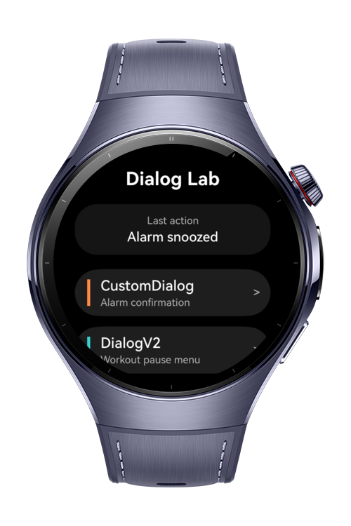
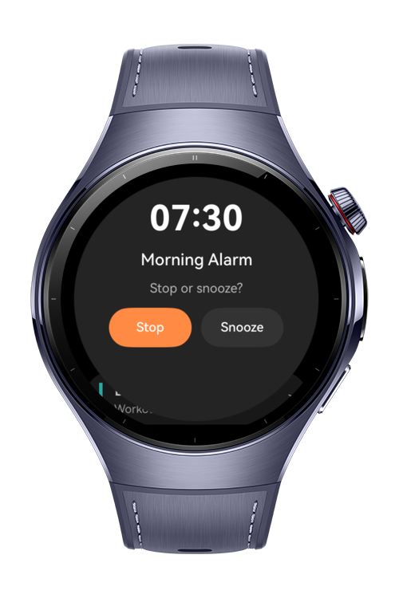
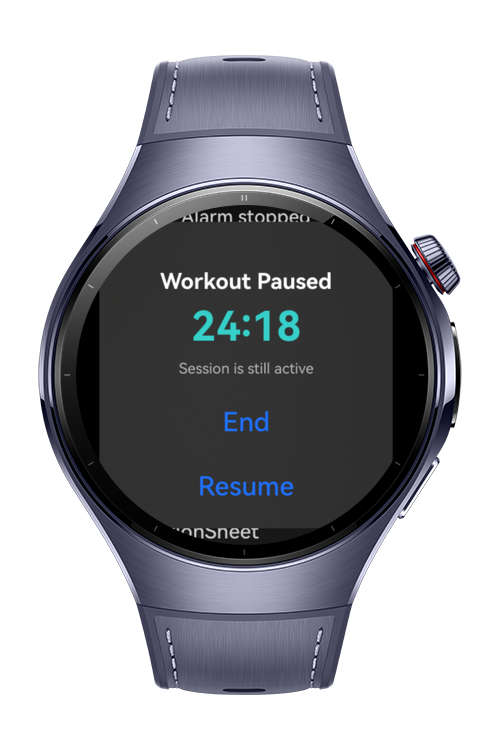
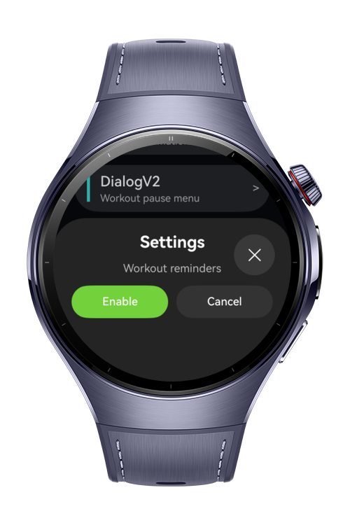

> **Note:** To access all shared projects, get information about environment setup, and view other guides, please visit [Explore-In-HMOS Index](https://github.com/Explore-In-HMOS/hmos-index).

# How to Build Dialog Patterns for HarmonyOS Wearables

A compact dialog pattern showcase for HarmonyOS Next smart wearables. The app demonstrates how to use different ArkUI dialog APIs on a round watch screen, including `CustomDialog`, DialogV2 components, sheet transitions, action sheets, and popover dialogs.

The codelab teaches how to choose the right dialog pattern for different wearable interactions such as alarms, workout controls, settings panels, notification actions, timer alerts, and quick replies. It focuses on small-screen usability, compact layouts, readable actions, and lightweight interaction flows.

# Preview

<div>
  
  
  
  
</div>

# Use Cases

* **Alarm Confirmation**: Demonstrates how to use `CustomDialog` for a fully custom round-screen confirmation dialog with Stop and Snooze actions.
* **Workout Pause Menu**: Shows how to use `CustomContentDialogV2` with custom content and dialog action buttons.
* **Settings Panel**: Demonstrates how to use Sheet Transition with `bindSheet` for a bottom settings panel.
* **Notification Actions**: Shows how to use `showActionSheet` for multiple lightweight user actions.
* **Timer Alert**: Demonstrates how to use `AlertDialogV2` for short confirmation-style alerts.
* **Quick Reply Popover**: Shows how to use `PopoverDialogV2` for anchored contextual actions near a target component.

# Technology

## Stack

* **Languages**: ArkTS, ArkUI
* **Frameworks**: HarmonyOS SDK 6.0.1(21)
* **Tools**: DevEco Studio Version 6.0.1.251
* **Libraries & Kits**:
  * **ArkUI**
    * `CustomDialog` — Builds a fully custom modal dialog
    * `CustomDialogController` — Opens and closes a custom dialog
    * `CustomContentDialogV2` — Displays custom content inside the DialogV2 system
    * `AdvancedDialogV2Button` — Defines DialogV2 action buttons
    * `AlertDialogV2` — Displays a compact alert dialog
    * `PopoverDialogV2` — Displays a popover dialog relative to a target component
    * `PopoverDialogV2Options` — Configures popover placement and spacing
    * `bindSheet` — Displays a sheet transition panel
  * **UIContext**
    * `showActionSheet` — Displays an action sheet from the current UI context
  * **PromptAction**
    * `openCustomDialog` — Opens DialogV2-based custom dialogs
    * `closeCustomDialog` — Closes DialogV2-based custom dialogs

## Required Permissions

This codelab does not require special permissions.

# Directory Structure

```text
entry/src/main/
├── ets/
│   └── pages/
│       └── Index.ets                 // Main UI page demonstrating dialog patterns
└── resources/
    └── base/
        └── element/
            ├── string.json           // Text resources used by the demo
            └── color.json            // Color resources used by the demo
```

# Constraints and Restrictions

## Supported Device

* Huawei Watch 5

## Requirements

* HarmonyOS API level 18 or higher for DialogV2 components
* HarmonyOS API level 20 or higher is recommended for the full wearable codelab environment
* DevEco Studio 6.0.1 or later

# License

How to Build Dialog Patterns for HarmonyOS Wearables is distributed under the terms of the MIT License.